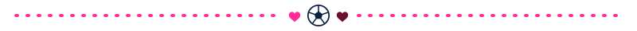
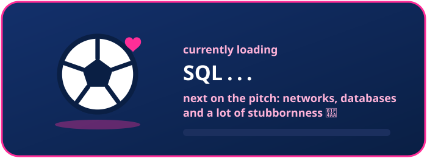
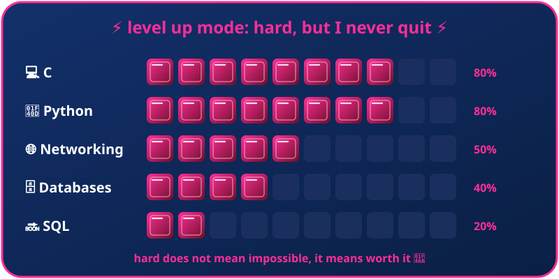
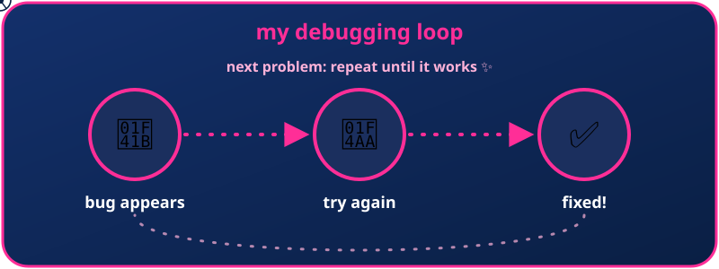
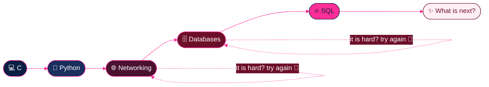
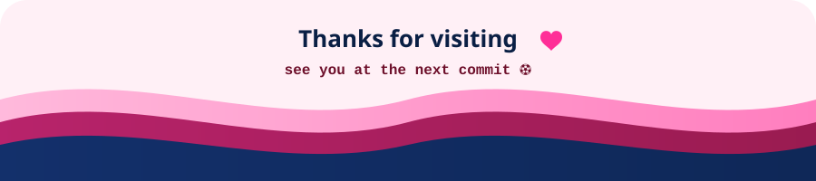

<div align="center">



<br>




</div>

### 💖 About Me

> Computer science is hard, and I will not pretend otherwise. Some days the code wins, but most days I do. I am a CS student at UIR who loves discovering the next "wow" thing about computers, moving step by step from C and Python to networking and databases, with good people around me and a sketchbook never far away. ⚽🎨

```yaml
yasmine:
  university: "UIR - Computer Science, 2nd year 🎓"
  survived: ["C", "Python"]
  fighting_now: ["Networking", "Databases", "SQL"]
  fav_colors: ["navy blue 💙", "bordeaux 🍷"]
  vibe: "funny, creative, pink neon 💖"
  loves: ["meeting people", "activities", "family", "friends", "drawing", "football ⚽"]
  hard_truth: "it is difficult, and I keep going anyway 💪"
  superpower: "curiosity + stubbornness"
  motto: "Hard is not a stop sign, it is a level up ✨"
```

<div align="center"></div>

### ⚡ What I Am Loading

<div align="center">



<br>



<br>



</div>

<div align="center"></div>

### 🥊 Boss Fights

<div align="center">

| Level | Boss | Status |
|:---:|:---|:---|
| 🛡️ **C** | Strict, unforgiving, the final form of "why won't it compile" | ✅ Defeated |
| 🐍 **Python** | Friendly on the surface, sneaky underneath | ✅ Defeated |
| 📡 **Networking** | Machines talking to each other, and me trying to follow | ⚔️ Fighting now |
| 🗄️ **Databases** | So much data, so many tables | ⚔️ Fighting now |
| 🔥 **SQL** | The next big striker | 🔜 Loading... |

</div>

### ⚽ My Journey



<div align="center"></div>

### 🧸 Tech Stack

<div align="center">


<br><br>


</div>

### ✏️ Sketchbook

<div align="center">



</div>

### 🐍 My Little Python Corner

<details>
<summary><b>Click to open 💖</b></summary>

```python
# How I deal with hard problems
tries = 0
solved = False

while not solved:
    tries += 1
    print(f"Attempt #{tries}: it is hard, but I keep going 💪")
    if tries == 3:
        solved = True

print(f"Solved after {tries} tries. Yasmine 1 - 0 Bug ⚽🏆")
```

</details>

### 🔮 Fun Facts

<details>
<summary><b>Click to reveal ✨</b></summary>

- 💪 CS is hard and I know it, I just do not know how to quit
- ⚽ Football is not just a sport, it is a lifestyle
- 🎨 If there is a blank page, I will doodle on it
- 👯 I love meeting new people and trying new activities
- 👨‍👩‍👧 Family and friends always come first
- 🧠 I get super excited by "wow" facts about computers

</details>

<div align="center"></div>

### 📊 GitHub Stats

<div align="center">


<br>


<br>


</div>

### 🐍 Contribution Snake

<div align="center">

<picture>
  <source media="(prefers-color-scheme: dark)" srcset="https://raw.githubusercontent.com/USERNAME/USERNAME/output/snake-dark.svg" />
  <source media="(prefers-color-scheme: light)" srcset="https://raw.githubusercontent.com/USERNAME/USERNAME/output/snake.svg" />
  
</picture>

</div>

### 🎀 Beyond the Code

- ⚽ **Football:** goals on the pitch, goals in my code
- 🎨 **Drawing:** my way to stay creative
- 👯 **People:** meeting new faces is my favorite side quest
- 💙 **Navy & bordeaux:** my colors, with a pink neon glow
- 💪 **Perseverance:** it is hard, and that is exactly why it feels so good when it works
- 🧠 **Curiosity:** always up for something new and "wow"

<div align="center">



</div>
